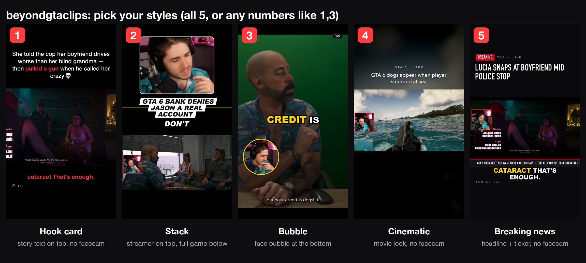

# beyondgtaclips: step-by-step guide

Turn the biggest GTA 6 streams into viral 9:16 reels for Instagram, TikTok, YouTube Shorts
and Facebook. Your AI assistant does all the work: you answer three questions and get
finished reels with captions, a hook and a ready-to-paste post.

Works with **Claude** (Claude Code or the Claude desktop app's Code tab) and **ChatGPT**
(the ChatGPT desktop app with Codex). Free: no API keys, no extra subscriptions.

---

## Part 1: Install (once, about 10 minutes)

### 1. What you need
- A Mac or a Windows PC with about 3 GB of free space and internet
- Claude (Claude Code / Claude desktop app) **or** ChatGPT desktop app with Codex
- Note: the normal claude.ai or chatgpt.com websites can't run it; it needs the app that
  works on your computer's files.

### 2. Install two free tools
Open the Terminal (Mac) or PowerShell (Windows) and paste:

- **Mac:** `brew install ffmpeg deno`
  (no Homebrew yet? install it first from brew.sh)
- **Windows:** `winget install Gyan.FFmpeg` then `winget install DenoLand.Deno`
  (close and reopen PowerShell afterwards)

### 3. Put the skill in your assistant's skills folder
Unzip `beyondgtaclips` and move the whole folder to:

| Assistant | Mac | Windows |
|---|---|---|
| Claude | `~/.claude/skills/beyondgtaclips` | `C:\Users\<you>\.claude\skills\beyondgtaclips` |
| ChatGPT (Codex) | `~/.codex/skills/beyondgtaclips` | `C:\Users\<you>\.codex\skills\beyondgtaclips` |

Using both? Put it in both places.

### 4. Let the assistant finish the setup
Open a new chat and type:

> **set up beyondgtaclips**

It installs its own private tools and speech models (about 5 minutes, once). Wait for **READY**.

**ChatGPT users:** ChatGPT will ask for permission to use the internet and save files.
Choose **Allow** (or **Always allow**). The skill needs the internet to reach YouTube and
saves your reels in a folder called `BeyondGTAClips` in your home folder.

---

## Part 2: Make reels (every time)

### Step 1: ask
Type:

> **Make GTA 6 clips**

### Step 2: answer three questions
The assistant asks:

1. **How many clips** do you want? (default 4)
2. **How recent** should the streams be: last **24 hours**, **48 hours** or **1 week**? (default 48 hours)
3. **Which style?** It shows you this picture. Pick a number, several (like `1,3`) or `all`.

| # | Style | Looks like |
|---|---|---|
| 1 | **Hook card** (default) | Story sentence on top with the action words in red, gameplay in the middle, captions under it |
| 2 | **Stack** | Streamer in a framed box on top, a line with the hook text, the caption, then the full game screen below |
| 3 | **Bubble** | Full-screen gameplay, the streamer's face in a circle at the bottom |
| 4 | **Cinematic** | Movie look: blurred backdrop, slow zoom, quiet subtitles |
| 5 | **Breaking news** | BREAKING headline, gameplay, red scrolling ticker |

Not sure? Just say **"default"**: 4 clips, last 48 hours, style 1 (Hook card).

Example answer: `6 clips, 24 hours, 1 and 3`

### Step 3: pick the streams
The assistant shows the most viewed GTA 6 streams in your time window, with views, age and
why each one ranks. Say which numbers to use, or **"take the top ones"**.

Streams that are still **LIVE** are listed separately: they can only be clipped after the
stream ends (usually ready within an hour).

### Step 4: wait (10-20 minutes per stream)
The assistant tells you what it's doing:
1. **Looking at the stream:** finds where the game is actually played (skips waiting, menus, chatting)
2. **Listening:** finds the loudest, most hyped gameplay moments
3. **Picking:** chooses the funniest, most shocking moments and writes a hook for each
4. **Making reels:** downloads only those seconds, checks they're real gameplay, edits them in your style
5. **Checking:** looks at every reel and fixes any hook that doesn't match the picture

### Step 5: post
You get a folder in `BeyondGTAClips/<date>/gta-6/<streamer>`:
- the reels (`.mp4`, 1080x1920)
- **POSTING.md**: for every reel the caption to paste, hashtags, two extra hooks to test,
  and a tip for adding a trending sound
- `checks/`: preview pictures of every reel

Before posting: watch each reel once, add a trending sound inside Instagram or TikTok at low
volume, and keep the streamer credit in the caption.

---

## Part 3: Change things (just ask)

| You want | Say |
|---|---|
| A different hook on a reel | "Change the hook of clip 2 to: Speed gets attacked by an alligator in GTA 6" |
| Another style for a reel | "Remake clip 2 in style 3" |
| Every style for comparison | "Remake all clips in all styles" |
| Longer story reels | "Make long clips, 60 to 90 seconds" |
| A specific stream | "Clip this stream: <YouTube link>" |
| A specific kind of moment | "Focus on police chases and NPC fails" |
| Another game | "Make Fortnite clips" |

Changing a hook or style takes about 15 seconds: nothing is downloaded again.

---

## Part 4: If something goes wrong

| Problem | Fix |
|---|---|
| "YouTube asks to confirm you're not a bot" | You searched a lot in a short time. Wait 20-30 minutes and try again. |
| "This stream is still LIVE" | Wait until it ends, or pick a finished stream. |
| "Unable to extract" / downloads fail | Say: "update yt-dlp for beyondgtaclips". |
| ChatGPT keeps asking for permission | Choose "Always allow" for this chat. |
| It stopped halfway | Ask again with the same words: it continues where it stopped. |
| Not enough disk space | Say: "clean the beyondgtaclips cache". |

---

## Rules
- Only clip creators who allow clipping (many big streamers run paid clipping programs).
- Always credit the streamer (the reels and captions already do).
- Don't post anything hateful or harmful, even as a joke.
