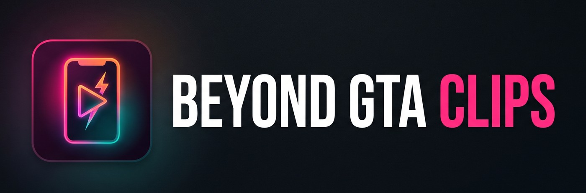
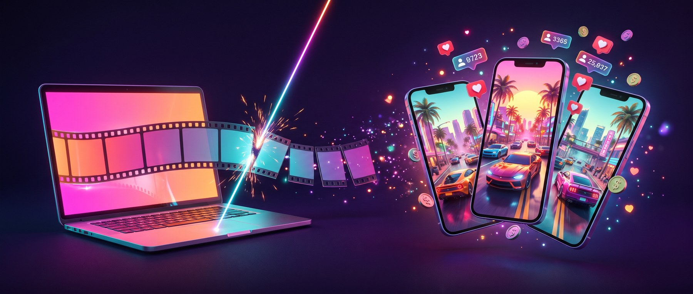
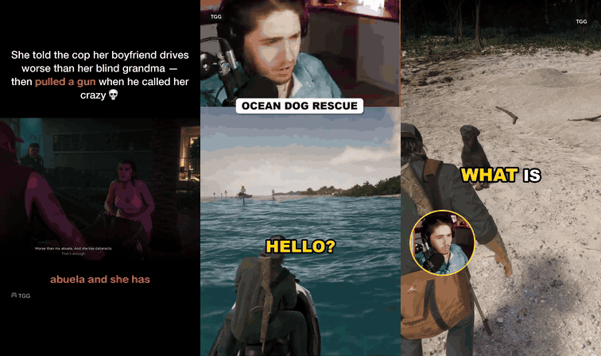
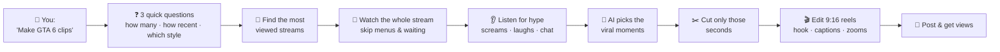
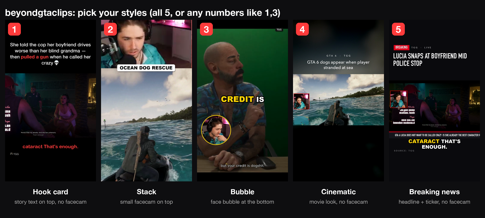
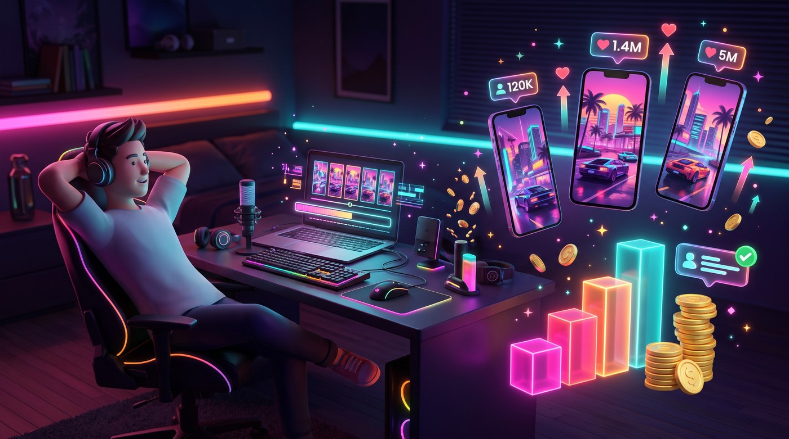
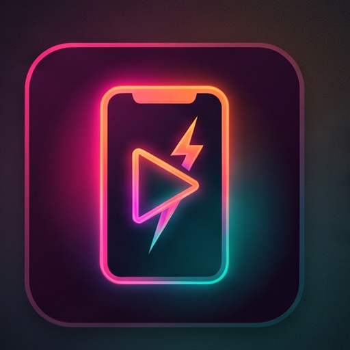

<p align="center">
  
</p>

<h3 align="center">Turn 10-hour GTA 6 streams into viral reels. Automatically. For free.</h3>

<p align="center">
  
  
  
  <br>
  
  
  
  
  
</p>

<p align="center">
  
</p>

---

## 🔥 Right now, someone is getting paid for a 30-second GTA 6 clip

GTA 6 is out, and the biggest streamers are live for **10 hours a day**.
Nobody watches 10 hours. Everybody watches **the 30 seconds where something crazy happens**:
the alligator attack, the police chase, the NPC meltdown, the streamer losing it.

The pages that post those 30 seconds first are getting **millions of views**. Brands and
streamers **pay clippers per view** to do exactly that.

The problem: finding those 30 seconds means watching hours of footage, cutting, cropping to
vertical, writing captions, adding text... for every single clip.

**Beyond GTA Clips does all of it for you.** You answer 3 questions. Your AI assistant finds
the most viewed streams, watches them, picks the moments that go viral and hands you
finished, ready-to-post reels.

<p align="center">
  
  <br>
  <sub>Real reels, made automatically from one GTA 6 launch stream. Left to right: Hook card, Stack, Bubble.</sub>
</p>

---

## ⚡ What it does

| | |
|---|---|
| 🔎 **Finds the streams** | Searches YouTube for the **most viewed** GTA 6 streams from the last 24 hours, 48 hours or week, skips re-uploads and compilations, and checks the language. |
| 👀 **Watches the whole stream** | Looks at the entire stream in seconds and skips the boring parts: waiting rooms, menus, just chatting. Only real gameplay. |
| 👂 **Listens for the hype** | Finds the moments where the streamer screams, laughs and chat explodes. |
| 🧠 **Picks the viral moments** | Your AI chooses the funniest, most shocking moments and writes a scroll-stopping hook for each one. |
| ✂️ **Cuts only what it needs** | Downloads only those seconds of video, not the whole 10 hours. |
| 🎬 **Edits like a pro** | 9:16 vertical, hook text, word-by-word captions, zooms, sound effects, in 5 viral styles. |
| ✅ **Checks its own work** | Looks at every reel and fixes any hook that doesn't match the picture. |
| 📋 **Writes your post** | Caption, hashtags, 2 extra hooks to A/B test and a trending-sound tip for every reel. |

---

## 🛠️ How it works (step by step)



1. **You say** *"Make GTA 6 clips"* to Claude or ChatGPT.
2. **It asks three questions:**
   - How many clips? *(default 4)*
   - Streams from the last **24 hours**, **48 hours** or **1 week**? *(default 48 hours)*
   - Which style? It shows you the five styles. Pick one, several, or all. *(default: Hook card)*
3. **It shows you the most viewed streams** with views and age. Pick some, or say *"take the top ones"*.
4. **It does the work** (about 10-20 minutes per stream) and tells you what it's doing.
5. **You get a folder of finished reels** plus a `POSTING.md` with the caption and hashtags for each one.
6. **You post them.** That's it.

---

## 🎨 Five viral styles

<p align="center">
  
</p>

| # | Style | What it looks like | Best for |
|---|---|---|---|
| **1** | **Hook card** ⭐ default | Story sentence on top with the action words in **red**, gameplay in the middle | Shocking moments, NPC chaos, discoveries |
| 2 | **Stack** | Small streamer cam on top, gameplay below, pop captions, punch-in zooms | Big reactions |
| 3 | **Bubble** | Full-screen gameplay, streamer's face in a circle at the bottom | Fast hype moments |
| 4 | **Cinematic** | Movie look, slow zoom, quiet subtitles | Beautiful or emotional scenes |
| 5 | **Breaking news** | BREAKING headline and a red ticker | Secrets, hidden features, big finds |

Every reel is **1080×1920**, keeps text away from the TikTok/Reels buttons, and still looks
right in Instagram's 4:5 feed crop.

---

## 💰 How people make money with clips

<p align="center">
  
</p>

There are four common ways. Beyond Tahir's tool makes the clips; the earning is up to you.

**1. Clipping campaigns (paid per view).**
Streamers and brands post campaigns on clipping marketplaces such as Whop's Content Rewards
and pay for every 1,000 views your approved clips get. In November 2026 the typical
(median) rate was **about $1 per 1,000 views**, with campaigns ranging from roughly
**$0.20 to $6**; gaming campaigns tend to sit on the higher side.
A clip that reaches 500,000 views on a $1 campaign is about **$500**.
([Content Rewards](https://contentrewards.com/articles/how-much-do-clippers-make),
[OpenClip](https://openclip.app/guides/make-money-clipping-videos))

**2. TikTok Creator Rewards.**
TikTok pays for qualified views on original videos **longer than 1 minute** (needs 10K
followers and 100K views in 30 days, in supported countries). Use **long mode** to make
60-90 second story clips that qualify.
([ShortSync](https://www.shortsync.app/resources/tiktok-creator-rewards-program-2026))

**3. YouTube Shorts & Facebook Reels.**
Grow a GTA 6 clip page and earn from the platforms' ad revenue programs once you qualify
(YouTube: Partner Program).

**4. Sell clipping as a service.**
Streamers pay clippers to grow their channels. Show them reels you made from their streams.

> ⚠️ Real talk: earnings depend on your clips, your page and the campaign rules. These are
> typical market rates, not promises. Only clip creators who allow it, and follow each
> campaign's rules (most pay only for approved clips and verified views).

**Tips that make clips go viral**
- Post **fast**: the first clips of a new moment get the views.
- Use the **hook text**: it decides whether people stop scrolling.
- Add a **trending sound** inside the app at low volume.
- Post **daily**, 3-5 reels. Test the 2 extra hooks from `POSTING.md`.
- Pick the streamers with clipping programs and post to every platform.

---

## 🚀 Quick start

**You need:** a Mac or Windows PC, about 3 GB free, and **Claude** (Claude Code / Claude
desktop app) or **ChatGPT** (desktop app with Codex). The normal claude.ai / chatgpt.com
websites can't run it.

**1. Install two free tools** (Terminal on Mac, PowerShell on Windows):

```bash
# Mac
brew install ffmpeg deno
```

```powershell
# Windows
winget install Gyan.FFmpeg
winget install DenoLand.Deno
```

**2. Add the skill** by putting this folder here:

| | Mac | Windows |
|---|---|---|
| **Claude** | `~/.claude/skills/beyondgtaclips` | `C:\Users\<you>\.claude\skills\beyondgtaclips` |
| **ChatGPT (Codex)** | `~/.codex/skills/beyondgtaclips` | `C:\Users\<you>\.codex\skills\beyondgtaclips` |

```bash
git clone https://github.com/beyondtahir/beyondgtaclips ~/.claude/skills/beyondgtaclips
```

**3. Say** *"set up beyondgtaclips"* (once, about 5 minutes), then *"make GTA 6 clips"*. 🎉

ChatGPT will ask for permission to use the internet and save files: choose **Allow**.

👉 **Full step-by-step guide:** [GUIDE.md](GUIDE.md)

---

## 💬 Things you can say

| You say | It does |
|---|---|
| *"Make GTA 6 clips"* | Asks 3 questions, then makes your reels |
| *"Make 6 clips from the last 24 hours, all styles"* | Skips the questions |
| *"Clip this stream: https://youtube.com/..."* | Uses that stream |
| *"Make long clips, 60-90 seconds"* | Story clips for TikTok Creator Rewards |
| *"Focus on police chases and NPC fails"* | Picks that kind of moment |
| *"Change the hook of clip 2 to ..."* | Re-renders in 15 seconds, no download |
| *"Remake clip 3 in the bubble style"* | Another style, 15 seconds |
| *"Make Fortnite clips"* | Works for any game |

---

## ❓ FAQ

<details>
<summary><b>Is it really free?</b></summary>

Yes. Everything runs on your own computer: speech recognition, editing and rendering.
No API keys, no credits. The AI that picks the moments is the Claude or ChatGPT you already use.
</details>

<details>
<summary><b>Does it work without any AI?</b></summary>

Yes. With no AI it picks moments from the loudest, most hyped parts of the stream. The AI
makes the picks and hooks much better, so we recommend using it.
</details>

<details>
<summary><b>Can it clip a stream that is still live?</b></summary>

Not yet: YouTube only allows cutting parts of a stream after it ends (usually within an hour).
It lists live streams separately so you can come back for them.
</details>

<details>
<summary><b>Twitch and Kick?</b></summary>

Yes, by link, or add your favourite creators to `~/BeyondGTAClips/watchlist.txt`.
The automatic search uses YouTube.
</details>

<details>
<summary><b>Other games?</b></summary>

Yes. Say *"make Fortnite clips"* (or any game). GTA 6 is just the default.
</details>

---

## 🧰 For developers

The engine is plain Python + ffmpeg + Pillow (all text is drawn with Pillow, so it looks the
same on every computer). Run it directly:

```bash
python3 scripts/beyondgtaclips.py setup
python3 scripts/beyondgtaclips.py styles
python3 scripts/beyondgtaclips.py find --within 48h
python3 scripts/beyondgtaclips.py clip --pick 1,2 --total 4 --styles 1
python3 scripts/beyondgtaclips.py remake "<folder>" --clip 2 --hook "New *hook* here"
```

Assistant instructions: [SKILL.md](SKILL.md) · Change log: [docs/CHANGES.md](docs/CHANGES.md)

---

## 🙏 Fair play

- Only clip creators who allow clipping. Many big streamers run paid clipping programs.
- Always credit the streamer (every reel and caption does this for you).
- Beyond GTA Clips is an independent tool. It is not affiliated with Rockstar Games, Take-Two,
  YouTube, TikTok, Instagram or any streamer. GTA and Grand Theft Auto are trademarks of
  their owners.

<p align="center">
  <br>
  <b>Beyond GTA Clips</b> · made by <b>Beyond Tahir</b><br>
  <sub>Long streams in. Viral clips out.</sub>
</p>
